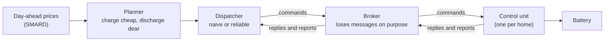

# vpp-dispatch-EU

A simulation of a **virtual power plant (VPP)** that trades 100 home batteries on real German electricity prices, and of what happens when the messages between the VPP and the batteries go wrong.

**The question:** when commands to home batteries are lost, repeated or out of date, how far does the VPP miss its schedule, and how much of that do idempotent commands, retries and state reconciliation fix?

## Key result

10% of messages lost in each direction, over 11 days of [SMARD](https://www.smard.de) day-ahead prices and 10 different loss patterns (seeds):

| Dispatcher | Tracking error, average (range) | Commands confirmed | Messages per command |
|---|---|---|---|
| Naive: sends each command once | 20.1 kW (18.2–21.4) | 81% | 1.00 |
| **Reliable: re-sends until confirmed** | **2.7 kW (2.2–3.1)** | **100%** | 1.24 |

- **Retries cut the error by about 87%**, and the reliable dispatcher wins in every run. With only commands lost, its error is exactly zero.
- **Repeated messages alone cause no error.** With 10% of messages arriving twice, both dispatchers track the plan exactly: the version number lets each battery spot the copy and apply it only once. Adding repeats to loss leaves both results unchanged.
- **What is left comes from lost battery reports.** The VPP plans with an out-of-date state of charge, and no retry can fix that. State reconciliation, the next phase, targets this.

*Tracking error* is the typical gap (RMSE) between what the VPP asked the batteries for and what they delivered.

## How it works



- **Every command has a version** that only goes up. A retry re-sends the identical command, and the control unit applies each version once. A repeat is answered `duplicate`, so retrying is always safe.
- **The reliable dispatcher** waits 15 s for a reply (the IEC 60870-5-104 default), then re-sends, doubling the wait each time, until the end of the 15-minute step.
- **Fair comparison:** whether a message is lost depends only on the message and the seed, so both dispatchers face exactly the same faults.

## Run it

```bash
cd simulation
python3 -m venv .venv && source .venv/bin/activate
pip install -e ".[dev]"
pytest                                        # 127 tests
python -m vppsim.experiments.commercial_vpp   # the comparison above, a few minutes
```

Code is in `simulation/vppsim` (field devices, network, VPP, experiments). Message formats are in `contracts/`, and the price data in `data/`. Power is in kW: positive means discharging to the grid.

## How this maps to German practice

| Link | In Germany | Here |
|---|---|---|
| VPP ↔ box at the home | The operator's own box over 4G (e.g. Next Kraftwerke's Next Box) | The broker: this is where messages are lost |
| Box ↔ battery | Modbus RTU or simple signals | A direct call (local and reliable) |
| Grid operator (TSO) ↔ VPP | Telecontrol, usually IEC 60870-5-104 | Not modelled: this VPP trades day-ahead only |
| Local grid operator ↔ home (§14a EnWG) | Smart meter gateway with an FNN control box; EEBus | Not modelled |

## Roadmap

- [x] **Phase 1:** simulation, naive vs reliable dispatch under message loss, CI
- [ ] **Phase 2:** state reconciliation, crash recovery with a command log, delays and outages, control units serving several devices
- [ ] **Phase 3:** VPP service in C# with a real MQTT broker and PostgreSQL
- [ ] **Phase 4:** failover between two VPP instances

## Limitations

- Batteries run in 15-minute steps, so a command confirmed after a retry counts for the whole step.
- Household consumption is not modelled; batteries only follow the VPP.
- The broker models failure *patterns* (loss, duplication), not real network protocols.

## License

MIT. Price data: Bundesnetzagentur | SMARD.de, CC BY 4.0.
